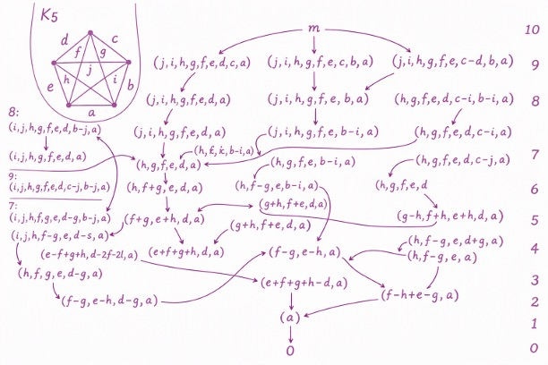

I am a PhD student at Mälardalen University, expected to graduate 2029. My main focus is Commutative Algebra, I am particularly interested in Koszul Algebras and Koszul filtrations.

My supervisors are:
Peder Thompson (main supervisor) MDU
Kathlen Kohn KTH
Alessandro Papadopulus MDU
Thomas Westerbäck MDU

A beautiful example of a Koszul filtration
======

  
  
<em> A Koszul Filtration for the Möbius algebra of the K5 graph (as shown in the upper left corner of the picture). Credit to my supervisor Peder Thompson for working it out.</em>

Macaulay2 package
======
Check out the Macaulay2 package KoszulFiltrations on my github, soon to be submitted to Maculay 2. 
